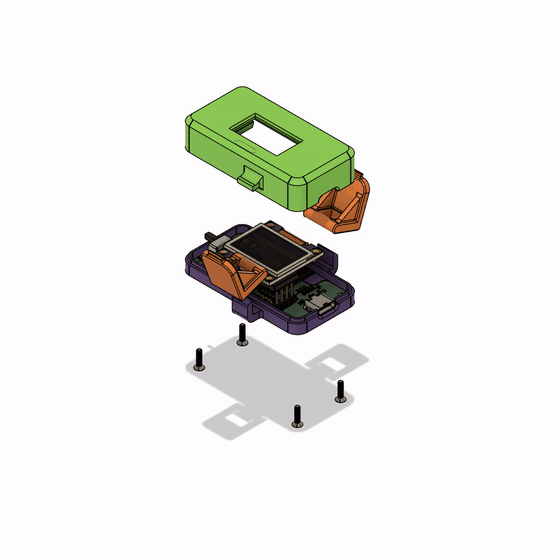
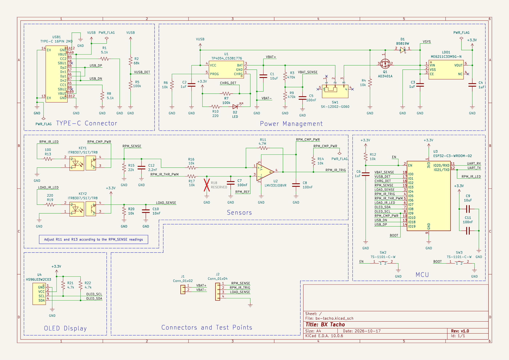

# BX Tacho

**English** | [繁體中文](README.zh-TW.md)

An open, DIY launch RPM meter for **Beyblade X** launchers. It clips onto the
back of the launcher, reads the launcher's spinning black/white pattern with an
IR sensor, and shows the launch RPM on a small OLED.



**Web app: [dazchi.github.io/bx-tacho](https://dazchi.github.io/bx-tacho/)**
(Chrome or Edge on a computer, Chrome on Android)

## What it does

- **Measures launch RPM** optically, up to about 20,000 RPM, and shows the
  result and the peak on the display.
- **Senses when a Bey is loaded** and when it's released, so each shot is
  recorded automatically: no buttons to press.
- **Keeps a shot history:** the last 50 shots, the total count, the best shot
  and the latest launch curve.
- **Bluetooth:** uses the Bey Battle Pass protocol, so Battle Pass apps can
  read your shots.
- **Runs on a 1S LiPo** with USB-C charging, a power switch, battery monitoring,
  and sleep when idle.
- **Left-handed mode:** the display can be turned 180°.

## Web app

The [web app](https://dazchi.github.io/bx-tacho/) runs in the browser, with
nothing to install:

- **Bluetooth:** live shot data, battery, the launch curve and your history.
- **Firmware updates** over USB or Bluetooth, with one click for the latest
  release.
- **A console** over USB or Bluetooth, for settings, calibration and
  diagnostics.

It's available in English, 繁體中文, 简体中文 and 日本語. Details:
[web/README.md](web/README.md).

## Hardware

An ESP32-C3 (ESP32-C3-WROOM-02) with two ITR8307 reflective IR sensors:
- one reads the RPM, through an LMV331 comparator;
- one detects a loaded Bey.

The rest of the board:
- a 0.96″ SSD1315 OLED;
- a TP4054 charger, with load sharing so it runs while charging;
- USB-C for power and data.



- [hardware/](hardware/): KiCad 10 project (schematic, PCB, footprints, 3D
  models). Gerbers and the BOM for JLCPCB assembly are in the
  [hardware v1.0 release](https://github.com/dazchi/bx-tacho/releases/tag/hw-v1.0).
- [mechanical/](mechanical/): STL files for the 3D-printed case:
  `case_top`, `case_bottom` and the launcher `clip`.

## Firmware

ESP-IDF v6.1 firmware in [firmware/](firmware/).

**Installing it:** use the web app's update button, or download the firmware
from [Releases](https://github.com/dazchi/bx-tacho/releases). Your settings
and shot history are kept.

**Building it yourself:**

```bash
cd firmware
idf.py build
idf.py -p COMx flash monitor
```

Build options, the console commands, calibration and the Bluetooth protocols
are covered in [firmware/README.md](firmware/README.md).

## License

[GPL-3.0-or-later](LICENSE). Copyright © 2026 Darren Chi
([github.com/dazchi](https://github.com/dazchi)). See [NOTICE](NOTICE) for
the exception covering the optional firmware extension.
